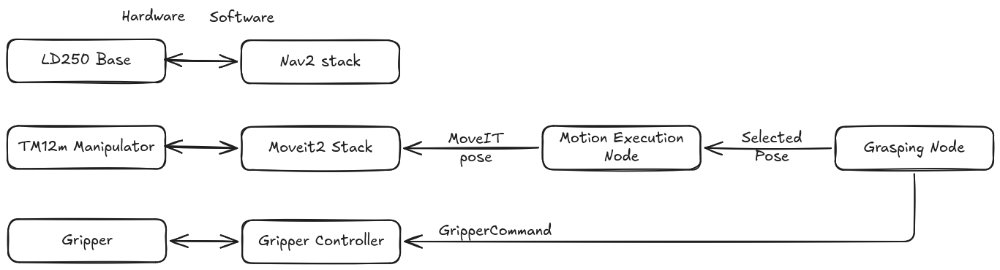

# Grasping Omron MOMA

This extends the [CollaborativeRoboticsLab/grasping](https://github.com/CollaborativeRoboticsLab/grasping) stack to support the Omron MOMA mobile manipulator with a TM12m arm and a soft two-finger gripper. It provides URDF/xacro descriptions and meshes for the robotic arm and gripper assemblies, as well as ROS2 launch files for controlling the manipulator and executing grasping tasks.



## Getting Started

- [Devcontainer connection](./docs/ld250_tm12x_connection.md)
- [Tf frames for gripper compatibility](./docs/ld250_tm12x_tf_frames.md)


## Starting the camera

Use the following command to start the realsense D435 camera.

```bash
source install/setup.bash
ros2 launch grasping_camera d435.launch.py
```

## Starting Omron Moma and Gripper with MoveIt

Use the following command to start the Omron MOMA manipulator and gripper with MoveIt.

```bash
source install/setup.bash
ros2 launch ld250_tm12x_soft_two_fingers_moveit_config hardware_with_moveit.launch.py
``` 
